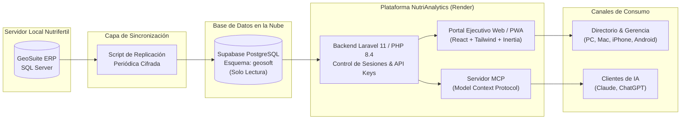

# MANUAL DE ENTREGA Y DOCUMENTACIÓN DEL PROYECTO
## NutriAnalytics • Portal Ejecutivo de Inteligencia Comercial & Integración con IA
**Cliente:** Nutrifertil S.A.  
**Proyecto:** Módulo de Reportes en Línea e Integración con Inteligencia Artificial  
**Versión:** Versión 1.0 (Entorno de Producción)  
**Fecha de Entrega:** Octubre 2026  
**Documento de Conformidad:** Fase 7 del Presupuesto (Pruebas, Documentación y Entrega)  

---

## 1. Resumen Ejecutivo de la Solución

El proyecto **NutriAnalytics** ha sido completado con éxito, cumpliendo la totalidad de los alcances técnicos y funcionales acordados en la *Propuesta de Solución Tecnológica*. 

La plataforma proporciona a la junta directiva, gerencia general y equipo comercial acceso remoto, instantáneo y seguro a la información operativa del ERP GeoSuite, sustituyendo los reportes manuales en papel o PDF por:
1. **Un Portal Web Ejecutivo (Dashboard y Reportería Inteligente):** Accesible desde cualquier navegador de escritorio y teléfono móvil (PWA instalable), con filtros dinámicos y exportación nativa a Excel y PDF ejecutivo.
2. **Un Servidor de Integración con Inteligencia Artificial (Protocolo MCP):** Permite a la gerencia conectar herramientas de IA de vanguardia (como Claude o ChatGPT) para formular preguntas en lenguaje natural y obtener respuestas analíticas en tiempo real basadas en datos reales.

---

## 2. Arquitectura de la Solución y Seguridad

### 2.1 Esquema de Datos y Flujo de Información

### 2.2 Principios de Seguridad y Aislamiento Garantizados
* **Acceso Estricto de Solo Lectura (`Read-Only`):** Ningún usuario ni agente de inteligencia artificial tiene conexión directa ni permisos de escritura sobre el servidor local de GeoSuite ni sobre la réplica en la nube.
* **Protección de Datos Sensibles:** La base de datos expuesta no contiene información de nómina, cuentas bancarias personales ni contraseñas internas del ERP.
* **Sesiones Cifradas y Persistentes:** La autenticación utiliza contraseñas con hash Bcrypt y almacenamiento de sesiones en base de datos en Supabase, garantizando que los usuarios no pierdan su sesión entre reinicios del servidor.

### 2.3 Catálogo de Información Documentado y Sincronizado
El sistema cuenta con las vistas analíticas curadas correspondientes a las áreas críticas del negocio:
* **Ventas y Facturación (`encfct`, `detfct`):** Histórico completo de facturación, montos netos, impuestos, costos, fechas y estados de facturas.
* **Inventarios y Bodegas (`existencias`, `productos`, `rubros`):** Niveles de stock en tiempo real, productos agotados, alertas de sobrestock y marcas comerciales (Yara, Monómeros, etc.).
* **Cuentas por Cobrar (`movcxc`, `clientes`):** Antigüedad de saldos (aging), vencimientos de cartera, clientes en mora y riesgo de abandono comercial (churn).
* **Estructura Comercial (`sucursales`, `vendedores`):** Agencias físicas y asignación de cartera por asesor comercial.

---

## 3. Manual de Usuario: Portal Ejecutivo Web

### 3.1 Acceso al Sistema
* **URL Oficial:** `https://nutrianalytics.onrender.com` (o dominio corporativo configurado).
* **Compatibilidad:** Google Chrome, Safari, Microsoft Edge, Mozilla Firefox (tanto en escritorio como en dispositivos móviles).

### 3.2 Módulo 1: Dashboard de Control Ejecutivo
El Dashboard consolida en una sola pantalla los indicadores más importantes del ciclo agrícola:
1. **Métricas Principales (KPI Cards):**
   * *Ventas Totales ($ USD)* del período seleccionado.
   * *Total de Facturas Emitidas*.
   * *Cartera por Cobrar ($ USD)* con porcentaje de mora.
   * *Ticket Promedio de Venta ($ USD)*.
2. **Pestaña Comparativa Interanual (YoY - 2026 vs. 2025):**
   * Curva visual de estacionalidad mes a mes.
   * Tabla analítica optimizada para móviles con diferencial en dólares (`$`) y porcentaje de crecimiento (`%`).
3. **Pestaña Matriz de Clientes y Cobranza (CxC):**
   * Semáforo de antigüedad de cartera (Corriente, 1-30 días, 31-60 días, 61-90 días, +90 días).
   * Alerta preventiva de **Abandono Comercial (Churn)**: detecta clientes clave que llevan más de 60 o 90 días sin comprar.
   * Tabla interactiva de los principales deudores con ordenamiento y búsqueda.
4. **Pestaña Cadena de Suministro (Inventarios):**
   * Semáforo de existencias (Agotados, Stock Crítico, Stock Óptimo, Sobrestock).
   * Alertas automáticas para compras y reabastecimiento de insumos de alta rotación.

### 3.3 Módulo 2: Centro de Reportería Inteligente
Diseñado para responder preguntas detalladas sin requerir un analista de datos:
* **Filtros Predictivos:** Rango de fechas libre o mediante *presets* agrícolas rápidos (Mes actual, Trimestre, Año a la fecha).
* **Criterios de Agrupación:** Puedes emitir el reporte por:
  1. *Detalle Factura por Factura*
  2. *Por Asesor Comercial (Vendedor)*
  3. *Por Marca / Insumo*
  4. *Por Sucursal*
* **Exportación con Feedback en Tiempo Real (Estilo Apple):**
  * **Exportar a Excel (.xlsx):** Genera un libro estructurado con formato corporativo, celdas numéricas y fórmulas de suma automáticas.
  * **PDF Directorio (1 Página):** Genera un reporte ejecutivo en PDF listo para juntas directivas con gráficos y resúmenes.
  * **Indicador de Progreso:** Una tarjeta dinámica y una barra de progreso superior notifican visualmente el avance (0% a 100%) y permiten cancelar la descarga si el usuario desea cambiar filtros.

### 3.4 Instalación como Aplicación Móvil (PWA) en Celulares
NutriAnalytics no requiere descargarse de App Store ni Google Play; se instala directamente:

* **En iPhone / iPad (Safari):**
  1. Abre `https://nutrianalytics.onrender.com` en Safari.
  2. Toca el botón central **Compartir** (el cuadro con una flecha hacia arriba `⬆`).
  3. Desplaza hacia abajo y selecciona **"Agregar a pantalla de inicio"**.
  4. Toca **"Agregar"**. La aplicación se abrirá a pantalla completa sin barra de navegación de Safari.
* **En Celulares Android (Google Chrome):**
  1. Al ingresar al sitio, aparecerá un banner inferior que dice *"Instalar NutriAnalytics"*.
  2. Toca el botón **"Instalar Aplicación"**.
  3. Quedará disponible en tu pantalla de inicio y en el cajón de aplicaciones de tu teléfono.

---

## 4. Guía de Integración con Inteligencia Artificial (Servidor MCP)

El sistema incorpora un servidor bajo el estándar abierto **Model Context Protocol (MCP)**, lo que permite a Nutrifertil conectar agentes de inteligencia artificial de última generación.

### 4.1 Datos de Conexión del Servidor MCP
* **Nombre del Servidor:** `NutriAnalytics AI Intelligence Server`
* **Transporte Web (Streamable HTTP):**  
  `https://nutrianalytics.onrender.com/mcp/agro`
* **Método de Autenticación:**  
  Cabecera HTTP `Authorization: Bearer <TU_API_KEY>`
* **Modo de Operación:** Exclusivamente de lectura (`SELECT`).

### 4.2 Catálogo de Herramientas Analíticas Expuestas a la IA
El servidor expone a la IA herramientas especializadas:
1. `get_executive_kpis`: Obtiene métricas globales de facturación, volumen de pedidos y cartera.
2. `get_sales_analytics`: Filtra y analiza ventas por vendedor, marca, sucursal o fechas específicas.
3. `get_accounts_receivable`: Consulta la cartera vencida, tramos de mora y clientes deudores.
4. `search_inventory_and_stock`: Consulta existencias y disponibilidad de productos por bodega.
5. `get_top_products`: Identifica los artículos más vendidos en unidades o monto total.
6. `get_table_schema`: Permite a la IA inspeccionar la estructura de las tablas autorizadas.
7. `execute_read_only_query`: Ejecuta consultas SQL seguras para preguntas imprevistas de negocio.

---

### 4.3 Configuración Paso a Paso: Claude (Vía Conector)

Para conectar **Claude** en la computadora de un director o gerente de manera directa y visual:

1. Abre la aplicación de **Claude**.
2. Ve a **Configuración** (`Settings`) > pestaña **Conectores** (o `Developer` / `Connectors`).
3. Haz clic en **"Agregar nuevo conector"** (o *Add Server / Add Connector*).
4. Completa los 3 campos solicitados:
   * **Nombre:** `NutriAnalytics`
   * **URL / Ruta:** `https://nutrianalytics.onrender.com/mcp/agro`
   * **API Key:** Ingresa la clave de autorización (Bearer Token) proporcionada para Nutrifertil.
5. Haz clic en **"Agregar" / "Conectar"**.

¡Listo! Aparecerá el indicador de herramientas activo en Claude, lo que le permitirá consultar en tiempo real ventas, existencias de inventario y saldos de cartera directamente en el chat.

---

### 4.4 Configuración en ChatGPT Plus (Custom GPTs / Actions)

Para directores que utilicen **ChatGPT**:

1. En ChatGPT, crea o edita tu **Custom GPT** corporativo (ej. *"Asistente Ejecutivo Nutrifertil"*).
2. En la pestaña **Configure**, dirígete a **Actions** y selecciona **"Create new action"**.
3. En la URL del servidor / OpenAPI, ingresa: `https://nutrianalytics.onrender.com/mcp/agro`.
4. En **Authentication**, selecciona **API Key (Bearer)** y coloca el token asignado.
5. Guarda los cambios.

---

### 4.5 Ejemplos de Preguntas que la Gerencia puede hacerle a la IA
Una vez conectado, cualquier usuario autorizado puede interactuar en lenguaje natural:

* *"Claude, ¿cuáles fueron las 3 marcas de fertilizantes más vendidas en el último trimestre y cuál fue su margen aproximado?"*
* *"Muéstrame los 5 clientes que tienen más de 60 días de atraso en cartera en la sucursal de San Vicente."*
* *"¿Cuánto inventario nos queda del producto 'Urea Granulada' y en qué sucursales está disponible?"*
* *"Genera una tabla comparativa de las ventas del asesor comercial Carlos López entre mayo y agosto, y dámela en formato CSV."*

---

## 5. Recomendaciones de Mantenimiento y Buenas Prácticas

1. **Monitoreo de la Sincronización Local:** Asegurarse de que el servicio o tarea programada que replica los datos de SQL Server hacia Supabase se mantenga en ejecución periódica (por ejemplo, cada 30 o 60 minutos) para que el portal refleje la información al día.
2. **Respaldo de Credenciales:** Mantener las API Keys del servidor MCP en un lugar seguro y renovarlas periódicamente desde la configuración si un directivo cambia de dispositivo.
3. **Escalabilidad y Nuevos Requerimientos:** La arquitectura modular del sistema permite incorporar con agilidad nuevas vistas, catálogos o consultas a medida que el negocio lo requiera, integrándolos de forma transparente tanto en el portal web como en el servidor de inteligencia artificial.

---

## 6. Acta de Conformidad y Entrega Final

Con la entrega del presente manual, la puesta en producción del panel web y la disponibilidad del servidor de Inteligencia Artificial (MCP), se formaliza la culminación satisfactoria del proyecto según la tabla de hitos acordada:

| Hito Presupuestario | Porcentaje | Monto (USD) | Estado |
| :--- | :---: | :---: | :---: |
| **Anticipo inicial** | 25% | $625.00 | Cancelado al inicio |
| **Primer Módulo (Dashboard y Reportes Web)** | 50% | $1,250.00 | **Completado y Validado** |
| **Entrega Final (Integración con IA y Manual)** | 25% | $625.00 | **Completado y Listo para Cierre** |
| **TOTAL DEL PROYECTO** | **100%** | **$2,500.00 USD** | **Finalizado** |

---

*Documento elaborado para Nutrifertil S.A. como entregable final de desarrollo de software.*
